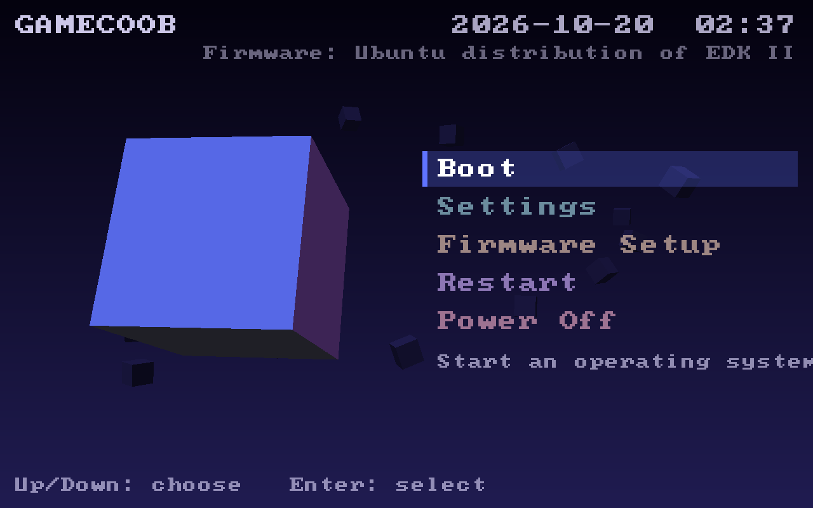
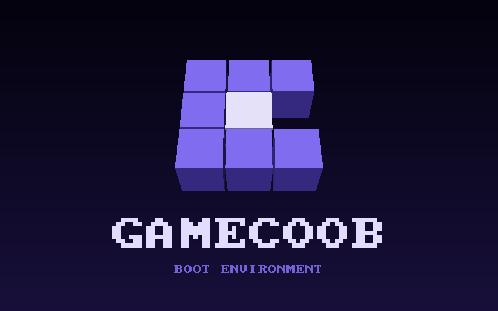
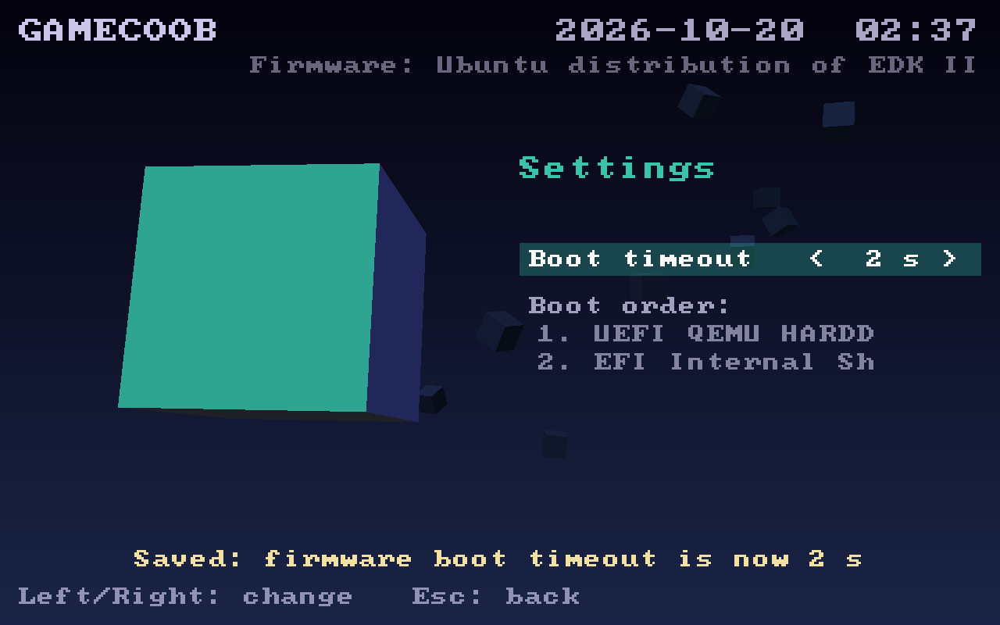

# GameCoob-Bios

A UEFI boot app that makes any x86-64 PC start up like a GameCube: a real-time
cube intro, then a console-style menu where you pick what to boot and change
firmware boot settings.

It runs after your motherboard's firmware and before any operating system, so
nothing gets flashed and nothing can be bricked. If something goes wrong, your
normal boot menu is still there.

| Intro | Menu |
| --- | --- |
|  |  |
|  |  |

## What works today

- **Intro.** A small cube tumbles around a grid, leaving tiles that trace a
  "C", hops into the middle, and the tiles rise into the logo. Drawn by our
  own software rasterizer, since there is no GPU driver before the OS loads.
  Press any key to skip. Press **Z** for the hidden alternate palette.
- **Boot.** Lists your firmware's boot entries and boots the one you pick (via
  the standard `BootNext` variable).
- **Settings.** Change the firmware boot menu timeout (the `Timeout` variable).
- **Firmware Setup.** Reboots straight into your vendor's BIOS setup screen
  (`OsIndications`), for settings this app can't reach yet.
- **Restart** and **Power Off**.

The menu shows a big cube that turns to a new colored face for each option.

## Assets and Nintendo content

This repository contains only original code and art. Nintendo's intro,
textures, fonts and sounds are **never** committed here. The plan is for the
app to load them, optionally, from an `ipl.bin` dump of your own console; see
[docs/ROADMAP.md](docs/ROADMAP.md).

## Build and run

You need Rust (stable) with the UEFI target, plus QEMU and OVMF to test.

```sh
rustup target add x86_64-unknown-uefi
sudo apt install qemu-system-x86 ovmf     # Debian/Ubuntu

cargo build --release                     # -> target/x86_64-unknown-uefi/release/gamecoob.efi
scripts/run-qemu.sh                       # boots it in a QEMU window
scripts/screenshots.py out/               # headless run that saves PNGs (needs Pillow)
```

In QEMU: arrow keys move, Enter selects, Esc goes back.

### On real hardware

1. Copy `gamecoob.efi` to a FAT32 USB stick as `EFI/BOOT/BOOTX64.EFI`.
2. Boot from the stick (Secure Boot must be off for now; the app is unsigned).
3. To make it your everyday boot screen, add it as the first boot entry, and
   turn on your firmware's quiet/fast boot to hide the vendor logo.

## Layout

```
src/
  main.rs    entry point: graphics setup, intro, menu
  intro.rs   the cube intro choreography and palettes
  menu.rs    main menu, boot list, settings, confirm dialogs
  gfx.rs     software renderer: canvas, triangle rasterizer, camera, font
  math.rs    vectors, rotation matrices, easing
  vars.rs    UEFI variables: Boot####, BootOrder, BootNext, Timeout, OsIndications
  clock.rs   TSC-based timer for frame-rate-independent animation
scripts/     QEMU runner and screenshot automation
docs/        roadmap and screenshots
```

## Roadmap

See [docs/ROADMAP.md](docs/ROADMAP.md) for the full plan: real BIOS options
through HII, controller input, intro audio, optional assets from your own IPL
dump, and the long-term firmware-level version.
