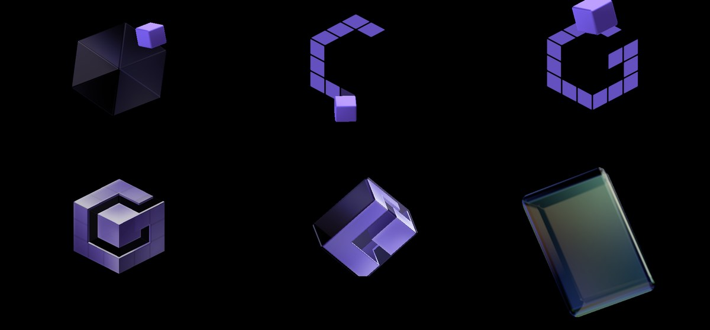
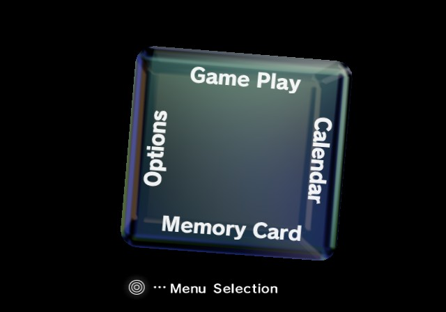
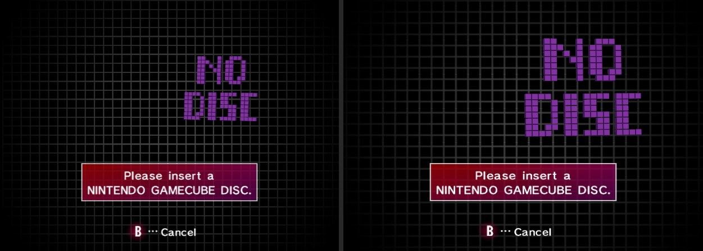
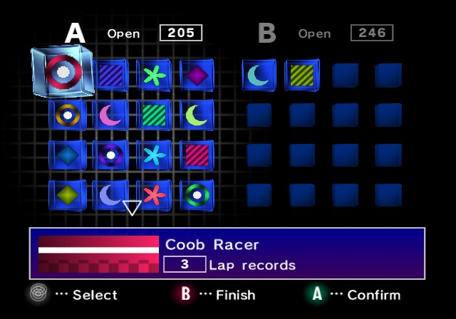
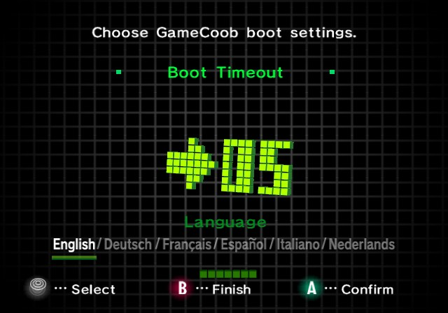
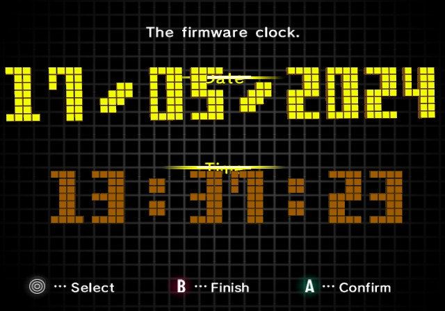

# GameCoob-Bios

A UEFI boot app that makes any x86-64 PC start up like a GameCube: the
console's own intro and cube menu, rebuilt from your own IPL dump, where you
pick what to boot and change firmware boot settings.

It runs after your motherboard's firmware and before any operating system, so
nothing gets flashed and nothing can be bricked. If something goes wrong, your
normal boot menu is still there.

The repository also holds a matching decompilation of the GameCube IPL's BS2
program (the intro and menus), aiming to rebuild every unit byte for byte with
the original CodeWarrior compiler, starting with PAL 1.0 and later every IPL
revision. The app is original Rust written from specs drawn from that work.

No Nintendo binaries or assets ship here. Both the app and the decomp read
everything they need from an `ipl.bin` you dump from your own console.

## Decomp progress

[](decomp/README.md) [](decomp/README.md)

[](decomp/README.md)

The matching decompilation of the IPL's BS2 program lives in [decomp/](decomp/README.md).

## What works today

- **The real GameCube intro, from your own console.** Put the `ipl.bin` you
  dumped from your GameCube at `\EFI\GameCoob\ipl.bin` on the boot
  partition and GameCoob plays the console's own boot animation: the cube
  drop, the rolling "G" with its fading trail, the flip and slam, the shake,
  the logo and the animated NINTENDO GAMECUBE wordmark, then the spin into
  the glass cube. The choreography was reimplemented from a decompilation of
  the IPL's BS2 program; the models and textures are read from your dump at
  boot. Hold **Enter** (the A button) while the cube rolls to spin it, as on
  the console. Esc skips.
- **The cube menu.** Game Play lists your firmware's boot entries and boots
  the one you pick (via the standard `BootNext` variable). Options changes
  the firmware boot menu timeout (the `Timeout` variable). F10 opens the
  system dialog: Firmware Setup (reboots into your vendor's BIOS setup via
  `OsIndications`), Restart and Power Off.
- **No dump, no show.** Without `ipl.bin`, GameCoob says where to put it and
  hands back to the firmware, which boots its next entry.

## Screenshots

Rendered by `tools/intro-render` and `tools/menu-render` from a PAL 1.0 dump.
The NINTENDO GAMECUBE wordmark is blanked out of these images.

**Intro**: the cube drop, the rolling "G", the logo, and the spin into the glass cube.



**Cube menu**



**Game Play**: real IPL in Dolphin (left) and GameCoob (right) at the same frame.



**Memory Card**: the save browser, here with fake test cards in both slots.



**Options**: the firmware boot menu timeout.



**Calendar**: the firmware clock.



## Assets and Nintendo content

Nothing from Nintendo is stored in this repository: no ROM data, binaries,
disassembly, models, textures, fonts or sounds. The screenshots above are
renders from a dump, with the NINTENDO GAMECUBE wordmark removed.

- **The app** is original Rust and original art. At boot it reads the
  intro's models, textures, fonts and sounds from an `ipl.bin` you dumped
  from your own console. Without one, it does not play the intro.
- **The decomp** is hand-written C that, compiled with the original
  toolchain, rebuilds the IPL's BS2 program byte for byte. Building or
  checking it also needs your own `ipl.bin`; the dump, the extracted
  `bs2.dol` and the generated assembly stay out of git.

See [docs/ROADMAP.md](docs/ROADMAP.md) for what is planned.

## Download

Every push to `main` is built by GitHub Actions. Open the latest run under
[Actions → Build](https://github.com/Bubbagum88/GameCoob-Bios/actions/workflows/build.yml)
and download **GameCoob-boot-files**. It holds `EFI\BOOT\BOOTX64.EFI`; copy
the `EFI` folder to a FAT32 USB stick and add your dump as
`EFI\GameCoob\ipl.bin`.

## Build and run

You need Rust (stable) with the UEFI target, plus QEMU and OVMF to test.
Put your own files in `local/` (git ignores it): your dump as
`local/ipl.bin` and any reference videos in `local/reference/`. The build
scripts pick up `local/ipl.bin` automatically.

On Windows (PowerShell):

```powershell
scripts\build.ps1                         # build; boot files land in target\esp
scripts\build.ps1 -Run                    # same, then boot it in QEMU for Windows
scripts\build.ps1 -Usb F:                 # same, then copy to a FAT32 USB stick
```

To try a downloaded build in **QEMU** (`winget install SoftwareFreedomConservancy.QEMU`),
drop the GameCoob-boot-files zip (or its unzipped folder) into `local\` and run
`scripts\run-qemu.ps1`. It picks the newest build, adds your `local\ipl.bin`
and boots it. Add `-Fast` to use Windows Hypervisor Platform.

To try it in **VMware Workstation**, unzip the download (or run
`scripts\build.ps1`) into `local\`, then run `scripts\make-vm.ps1`. It asks
for administrator rights, builds a small virtual disk with the boot files and
your `local\ipl.bin`, and writes `local\vm\GameCoob.vmx`; open that in VMware
and power it on. Re-run the script after each new download.

On Linux:

```sh
rustup target add x86_64-unknown-uefi
sudo apt install qemu-system-x86 ovmf     # Debian/Ubuntu

cargo build --release                     # -> target/x86_64-unknown-uefi/release/gamecoob.efi
scripts/run-qemu.sh                       # boots it in a QEMU window
IPL=~/ipl.bin scripts/run-qemu.sh         # same, with a dump from somewhere other than local/
scripts/screenshots.py out/               # headless run that saves PNGs (needs Pillow and your dump)
```

In QEMU: arrow keys are the d-pad, Enter is A, Esc or Backspace is B, Space is START.

### On real hardware

1. Copy `gamecoob.efi` to a FAT32 USB stick as `EFI/BOOT/BOOTX64.EFI`.
2. Boot from the stick (Secure Boot must be off for now; the app is unsigned).
3. To make it your everyday boot screen, add it as the first boot entry, and
   turn on your firmware's quiet/fast boot to hide the vendor logo.

## Layout

```
src/
  main.rs    entry point: load the dump, graphics setup, hand over to the intro
  boot_intro.rs  loads ipl.bin from the ESP and runs the intro and menu on all CPU cores
  bs2/       the intro and cube menu rebuilt from BS2: cube and scene state machines,
             GX-style TEV renderer and banded rasterizer, J3D animations, menus
  ipl/       ipl.bin parsing: descrambling, resource archive, Yay0, J3D, textures
  gfx.rs     backbuffer: scales each frame to a 4:3 picture, one GOP blit
  firmware.rs  menu actions: BootNext, Timeout, firmware setup, restart, power off
  vars.rs    UEFI variables: Boot####, BootOrder, BootNext, Timeout, OsIndications
  clock.rs   TSC-based timer for frame-rate-independent animation
scripts/     build.ps1 (Windows build), QEMU runner, screenshot automation
local/       your own dump and reference files, never committed
tools/       host-side checks: ipl-preview (models to PNG), intro-render and menu-render (frames to PNG)
docs/        roadmap
```

## Roadmap

See [docs/ROADMAP.md](docs/ROADMAP.md) for the full plan: real BIOS options
through HII, controller input, intro audio, optional assets from your own IPL
dump, and the long-term firmware-level version.
