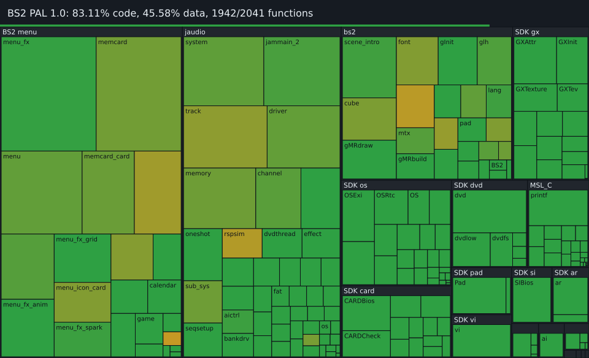

# GameCube IPL (BS2) decompilation, PAL 1.0

 

Each box is one source file, sized by its code bytes: green is matched
byte for byte, yellow to green is partly matched, grey is still assembly.
`python configure.py progress` (also the last ninja step) redraws these from
objdiff's report; `progress/history.csv` keeps one line per day
([chart](progress/history.svg)).

A matching decompilation of the GameCube boot ROM's BS2 program: the intro
(cube, scene director), the main menu (cube menu, Game Play, Memory Card,
Options, Calendar) and the Dolphin SDK it links. Matched files rebuild the
original `bs2.dol` byte for byte; the rest links from assembly. It is kept
apart from the GameCoob app in the rest of this repository; the app is
original Rust written from the specs in `docs/`.

- `src/bs1/bs1.s`: BS1, the hand-written boot stub at the reset vector (matching: `ninja` assembles it and checks `config/PAL10/bs1.sha1`)
- `src/bs2/`, `include/bs2/`: decompiled BS2 C, one comment per function with its address
- `src/dolphin/`, `include/dolphin/`: the Dolphin SDK parts BS2 links (os, base, mtx so far)
- `docs/sdk_libs.md`: SDK library map, compiler (GC/1.2.5n) and matched units
- `docs/intro.md`, `docs/menu.md`: behavior specs (timings, state machines, layouts)
- `config/PAL10/`: decomp-toolkit config, symbols and splits
- `tools/extract_bs2.py`: descrambles your own `ipl.bin` into `bs2.dol`

No Nintendo binaries are included. To build, dump `ipl.bin` from your own
console, put it at `orig/PAL10/ipl.bin` (git ignores it), and follow
`docs/getting_started.md` (dtk-template layout).
